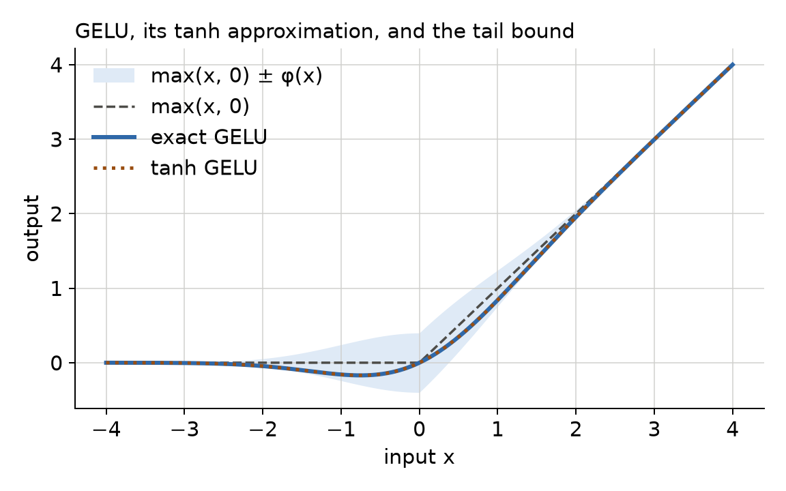
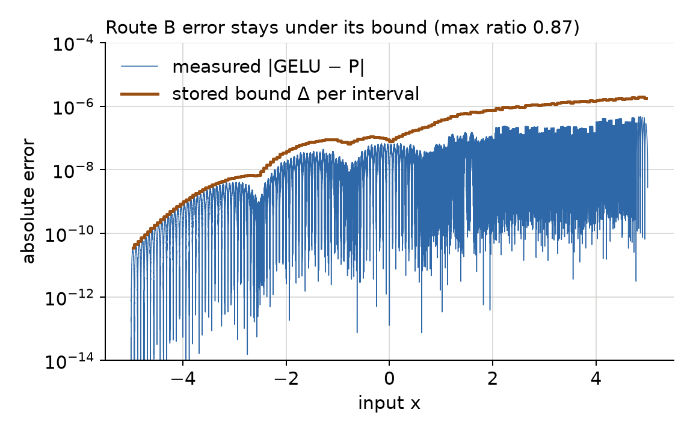
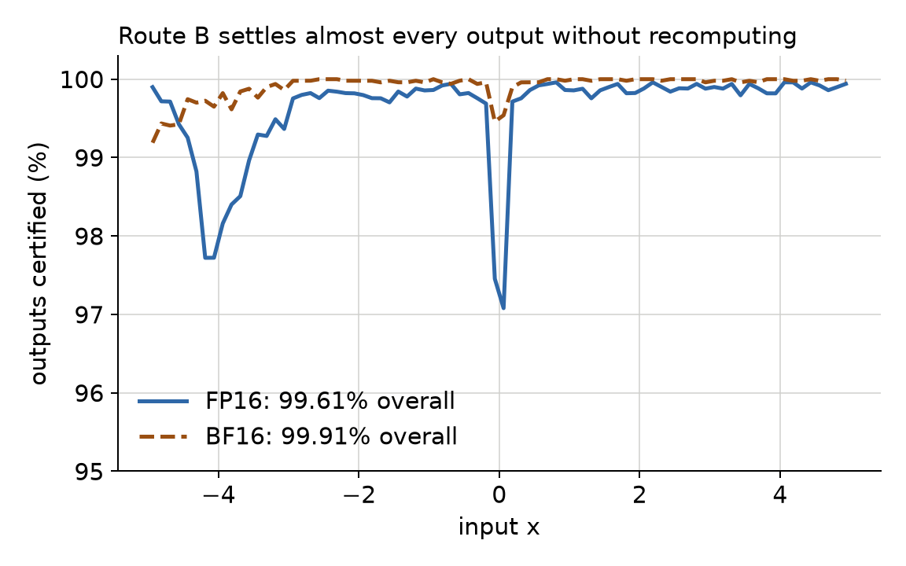
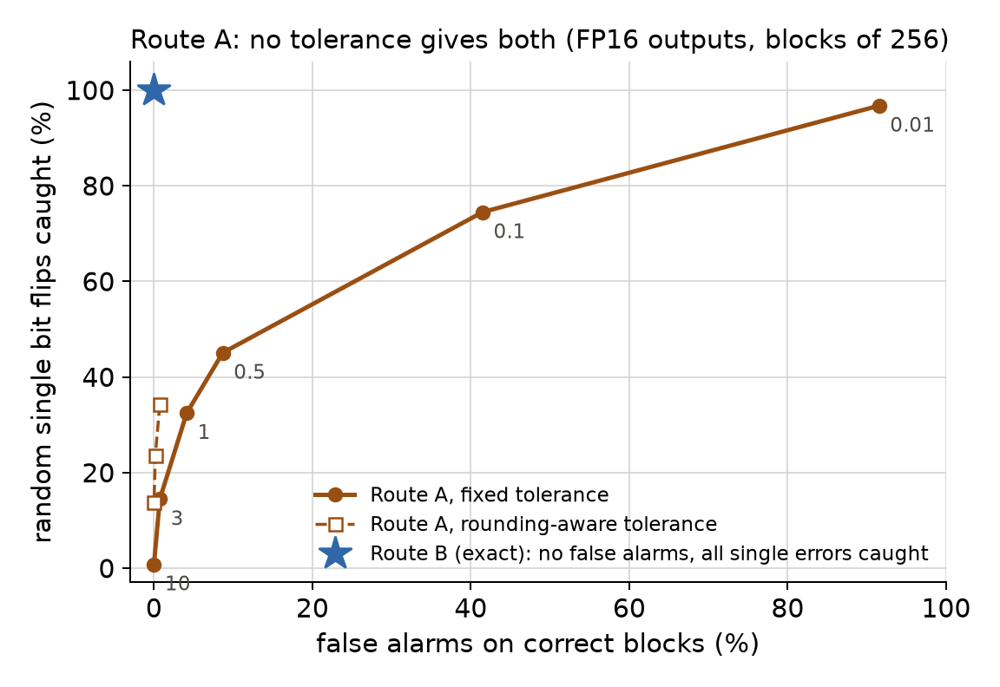
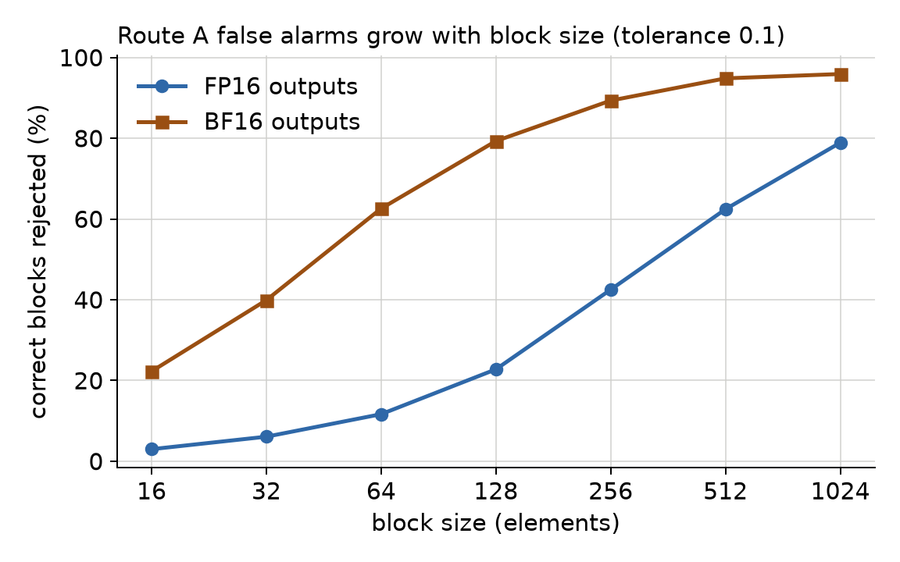

# Efficient GELU Checksums for Transformer Inference

Ilia Hashemi Rad, Sean Chang · ECE 69500 Systems for AI · Fall 2026

**Research question:** Can a checksum catch silent errors in GELU as reliably as recomputing it, at lower cost?

A hardware fault can change a result with no error message (silent data corruption). Matrix products,
softmax, LayerNorm, sigmoid and tanh already have cheap checks. GELU does not. It is nonlinear, so a matrix
checksum cannot pass through it, and the exact protection used today is to run it twice. This repository holds
the CPU reference checks behind our project proposal. These are small experiments that test whether each idea
is worth building on a GPU.

## Two routes

| Route | GELU variant | Idea | Cost per block |
|---|---|---|---|
| A | tanh approximation, `GELU(approximate='tanh')` | batch identity: `prod(x − y) = exp(−κ(Σx + cΣx³)) · prod(y)` | sums, products, one `exp` |
| B | exact GELU, `x·Φ(x)` | a 12.8 KB table of cubics predicts the exact 16-bit output; one checksum per block | one cubic per element, one checksum |

Route B works in two steps:

1. **Certify.** The cubic gives a value `p` and a proven error bound `Δ`. If `[p − Δ, p + Δ]` lies inside one
   FP16 or BF16 rounding cell, that cell's value is the exact output. Otherwise, that input is recomputed.
2. **Check.** It compares `D = Σ rᵢ (writtenᵢ − predictedᵢ) mod 65537` with 0. One wrong output always
   gives `D ≠ 0`.



## Results so far (CPU, NumPy)

### Route B works

- **The bound holds.** At 2 million test points on [−5, 5], the largest measured error is 0.87 of the
  stored bound.
- **Almost every output is settled without recomputation.** The table certifies 99.56% (FP16) and 99.93%
  (BF16) of outputs for standard-normal inputs, and 99.62% and 99.90% for uniform inputs. There were 400,000
  inputs per test, and **no certified output was wrong**.
- **The checksum works.** In 200,000 trials, every block with one wrong output was caught. For a fixed pair of
  wrong outputs, 325 of 20 million trials escaped (1.6 × 10⁻⁵). That is close to the theoretical bound
  2⁻¹⁶ ≈ 1.5 × 10⁻⁵.




### Route A is the weak link

With 16-bit outputs, correct values are rounded. Over a block of 256, that rounding moves the two sides of
the identity apart, so a tolerance is needed. No fixed tolerance gives both few false alarms and good
detection. Test setup: FP32 inputs, FP16 outputs, 20,000 blocks per point, one random bit flipped in one
output per block.

| Tolerance (log units) | Correct blocks rejected | Bit flips caught |
|---|---|---|
| 0.1 | 41.5% | 74.5% |
| 1 | 4.2% | 32.5% |
| 10 | 0.01% | 0.8% |
| rounding-aware, α = 1 | 0.74% | 34.2% |



False alarms grow with block size, and BF16 outputs are worse than FP16. With 16-bit inputs, some blocks
fail at any tolerance: in a correct block, x − y can come out exactly 0.



**Next step:** try smaller blocks for Route A, or apply Route B's exact approach to tanh GELU.

Full outputs are in [`results/`](results/).

## What these results do not show

- **GPU cost.** All runs here are on the CPU. The proposal's success criterion, lower latency than optimized
  recomputation, needs GPU kernels and timing.
- **Real activations.** The inputs are synthetic (normal and uniform), not tensors captured from a model.
- **Fault model.** Only output bit flips are tested, not faults inside the arithmetic.
- **Checker precision.** Route A's checker runs in float64 here. An FP32 checker would do worse.

## Run it

```bash
python -m venv .venv && .venv/bin/pip install -r requirements.txt
export PYTHONPATH=.:scripts
.venv/bin/python -m pytest -q                      # 6 tests, about 1 s
.venv/bin/python scripts/run_route_b.py            # bound, certification, checksum (about 4 s)
.venv/bin/python scripts/run_route_a.py            # tolerance trade-off, block size, formats
.venv/bin/python scripts/check_proposal_math.py    # formulas from the proposal
.venv/bin/python scripts/make_figures.py           # regenerates every figure in figures/
```

All runs use fixed random seeds. Every figure is computed from a fresh run; no numbers are typed in by hand.

## Layout

```
gelucheck/
  gelu.py      exact and tanh GELU, derivatives, accurate normal CDF
  formats.py   FP16 / BF16 rounding and rounding cells
  route_b.py   table construction, FP32 evaluation, certification, checksum
  route_a.py   batch-identity mismatch, block test, bit flips
scripts/       experiments and figure generation
tests/         property tests (identity, tail bound, BF16 rounding, bound, checksum)
results/       saved script outputs
figures/       generated plots
```

## References

- K.-H. Huang and J. A. Abraham. Algorithm-Based Fault Tolerance for Matrix Operations. IEEE Trans. Computers, 1984.
- D. Hendrycks and K. Gimpel. Gaussian Error Linear Units (GELUs). [arXiv:1606.08415](https://arxiv.org/abs/1606.08415)
- J. Guan et al. Strix: Re-thinking NPU Reliability from a System Perspective. [arXiv:2604.10484](https://arxiv.org/abs/2604.10484)
- K. Ahmadi et al. MAED: Mathematical Activation Error Detection. [arXiv:2603.18120](https://arxiv.org/abs/2603.18120)
- Z. Chen et al. Communication-Efficient Verifiable Attention for LLM Inference. [arXiv:2606.16352](https://arxiv.org/abs/2606.16352)
- K. Lei et al. Safeguarding LLM Training at Scale: Online SDC Detection and Insights from 35 Million GPU Hours. OSDI 2026.
- W. Zheng et al. SDCs in the Wild: Characterizing and Diagnosing SDC-defective GPUs in Production LLM Training. OSDI 2026.
- A. Ziv. Fast Evaluation of Elementary Mathematical Functions with Correctly Rounded Last Bit. ACM TOMS, 1991.
- J. P. Lim and S. Nagarakatte. High Performance Correctly Rounded Math Libraries for 32-bit Floating Point Representations. PLDI 2021.
