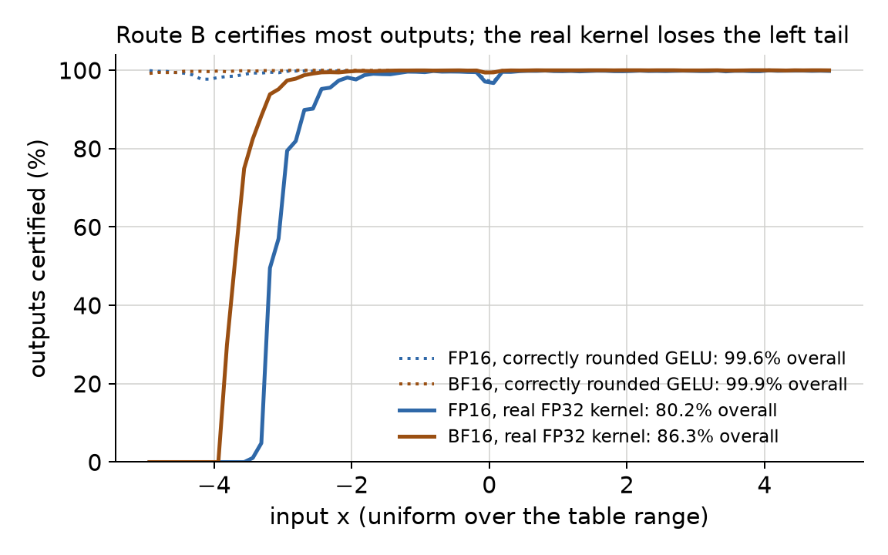
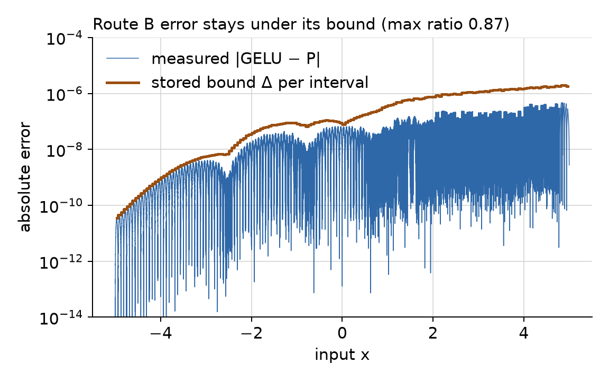

# Efficient GELU Checksums for Transformer Inference

Ilia Hashemi Rad, Sean Chang · ECE 69500 Systems for AI (Yi Ding) · Purdue, Fall 2026

**Research question:** Can a checksum catch silent errors in the GELU activation as reliably as running GELU
twice, at lower cost?

A hardware fault can change a result with no error message. This is *silent data corruption* (SDC). Matrix
products, softmax, LayerNorm, sigmoid and tanh already have cheap checks. GELU does not. It is nonlinear, so a
matrix checksum cannot pass through it, and the protection used today is to run it twice. This repository holds
the code, the experiments and the project notes.

## Contents

- [Course project requirements](#course-project-requirements)
- [Problem and motivation](#problem-and-motivation)
- [Research gap](#research-gap)
- [Design](#design)
- [Results so far](#results-so-far-cpu-numpy)
- [Evaluation plan and status](#evaluation-plan-and-status)
- [Risks](#risks)
- [How we chose this project](#how-we-chose-this-project)
- [Run it](#run-it)
- [Background reading](#background-reading)
- [References](#references)

## Course project requirements

The project is 60% of the course grade. It must pose a clear research question and make an evaluable systems
contribution. Running an existing model and reporting its performance is not enough. Any substantive AI use must
be disclosed in the submitted work: the tool, its purpose, and how we verified the output.

| Milestone | Weight | Due | State |
|---|---:|---|---|
| Project concept | 5% | Sep 24 | Done |
| Written proposal (2 pages: design, baselines, workloads, metrics, resources, risks) | 10% | before Oct 27 | Done |
| Proposal presentation (7 min + questions) | 10% | Oct 27 or 29 | Done |
| Final presentation (10 min + 5 min questions) | 10% | **Dec 1 or 3** | Open |
| Final report (5 pages, conference style) + code, data, reproducibility material | 25% | **Dec 11, 11:59 p.m.** | Open |

## Problem and motivation

SDC is rare on one device, but large GPU fleets see it often. In 35 million GPU-hours of LLM training, AEGIS
found 18 SDC incidents and 13 faulty GPUs [Lei et al.]. One incident in a task with about 10,000 GPUs caused clear
loss and gradient-norm spikes. SDCHunter reports that synthetic stress tests miss more than 60% of SDC-defective
GPUs [Zheng et al.]. A defective GPU keeps corrupting results until someone finds it.

A *checksum* catches such errors at low cost. It computes a small extra value twice: once from the inputs, with a
rule that predicts the result, and once from the actual output. If the two disagree, the output is wrong. For a
matrix product `C = AB`, the column sums of `C` must equal `(1ᵀA)B`, so one extra vector product checks the whole
matrix. This is algorithm-based fault tolerance (ABFT) [Huang and Abraham].

## Research gap

Most Transformer components already have a check of this kind:

| Component | Existing check |
|---|---|
| Linear layers, attention | ABFT: ALBERTA, EFTA |
| Softmax, LayerNorm | sum rules (softmax outputs sum to 1): EFTA, Strix |
| Sigmoid, tanh | compare with an independent approximation, within a tolerance: MAED, Redinbo |
| ReLU | cheap enough to recompute: MAED |
| **GELU** | **a redundant copy (Strix), or a range check only (Xue et al., Ma et al.)** |

A range check misses wrong values that stay in range. GELU(1) ≈ 0.841, and a faulty 0.6 still looks normal. We
found no check that predicts the exact GELU output at a cost below running GELU again.

## Design

### Two routes

| Route | GELU variant | Idea | Cost per block |
|---|---|---|---|
| A | tanh approximation, `GELU(approximate='tanh')` | batch identity: `prod(x − y) = exp(−κ(Σx + cΣx³)) · prod(y)` | sums, products, one `exp` |
| B | exact GELU, `x·Φ(x)` | a table of cubics predicts the 16-bit output of the kernel; one checksum per block | one cubic per element, one checksum |

The proposal builds on Route B. Route A is kept as a negative result (see below).

### Route B in detail

1. **Offline table.** Split [−5, 5] into 160 intervals of width 1/16. On each, fit a cubic that matches GELU and
   its slope at both ends. Because `|g⁗| ≤ 4/√(2π)`, the fit error is below 6.35 × 10⁻⁸. Adding the FP32
   rounding of the evaluation gives a bound `Δⱼ` per interval. The table is 3.2 KB (12.8 KB for [−20, 20]).
2. **Certify.** Evaluate the cubic to get `p`. The true value lies in `[p − Δⱼ, p + Δⱼ]`. A real kernel computes
   `0.5·x·(1 + erf(x/√2))` in FP32, and its output is not always the correctly rounded value. Its output lies
   within `Kⱼ` of the true value, where `K = 2.25·U·|x| + U·|y|` and `U = 2⁻²⁴`. This follows from the FP32
   operations and from NVIDIA's stated limit of 2 ulp for `erff`. If the window `[p − Δⱼ − Kⱼ, p + Δⱼ + Kⱼ]`
   lies inside one FP16 or BF16 rounding cell, every output that such a kernel can produce rounds to that cell's
   value. The prediction is then exact for any kernel inside the bound, whatever `erf` code it uses. If not,
   the input is not certified, and a second run of the same kernel decides. This is the
   fast-path-plus-fallback pattern of Ziv and RLIBM. `route_b.certify` has two targets: `"kernel"` (this one)
   and `"exact"` (the correctly rounded GELU, margin `Δⱼ` only).
3. **Check.** With random multipliers `rᵢ`, compute `D = Σ rᵢ (written bitsᵢ − predicted bitsᵢ) mod 65537` over the
   certified outputs of a block. If all outputs are right, `D = 0`. One wrong output always gives `D ≠ 0`. Several wrong outputs cancel
   with probability at most 2⁻¹⁶ (2⁻³² with two checksums). If `D ≠ 0`, recompute the block.


**Scope.** *In:* transient faults in the GELU arithmetic and in the store of its output; one GPU; exact GELU with
FP32 inputs and FP16 or BF16 outputs. *Out:* faults in the inputs or in the checker itself; the tanh
approximation and SiLU (possible extensions); training.

**Contribution.** The parts are known (fast path plus fallback, random checksums). Our contribution is the GELU
checksum and its cost against duplication. Two properties separate it from duplication. A duplicate repeats a
fault that comes from a defective unit, and the table does not. A duplicate matches only its own compiled code,
and a certified prediction holds for every kernel inside the error bound. Both properties hold for certified
outputs only: the second pass for the other outputs is a duplicate.

## Results so far (CPU, NumPy)

### Route B works

- **The bound holds.** At 2 million test points on [−5, 5], the largest measured error is 0.87 of the stored
  bound.
- **Almost every output is settled without recomputation.** With 400,000 inputs per test:

  | Target | FP16, normal | BF16, normal | FP16, uniform | BF16, uniform |
  |---|---|---|---|---|
  | `exact` (correctly rounded GELU) | 99.56% | 99.93% | 99.62% | 99.90% |
  | `kernel` (the real FP32 kernel) | 99.15% | 99.87% | 80.23% | 86.33% |

  No certified output differed from its target's reference. The `exact` predictions do differ from the modelled
  kernel (246 of 400,000 for FP16 normal inputs, 59,757 for uniform inputs), so `exact` is not a safe reference
  for a real kernel. The uniform numbers drop because the kernel loses accuracy for x below about −3, where
  `1 + erf` cancels. Model inputs are close to normal, so the normal column is the one that matters.

  

  The figure shows where the loss is: for uniform inputs, the kernel target certifies almost nothing below about
  x = −3.5 for FP16 and −3.9 for BF16 (solid lines), and the exact target certifies almost everything (dotted lines).
- **The checksum works.** In 200,000 trials, every block with one wrong output was caught. For a fixed pair of
  wrong outputs, 325 of 20 million trials escaped (1.6 × 10⁻⁵). That is close to the theoretical bound
  2⁻¹⁶ ≈ 1.5 × 10⁻⁵.

The written proposal quotes 99.57 / 99.94 / 99.91% and 326 escapes, from an earlier run. Use the numbers above,
which `scripts/run_route_b.py` reproduces.



### First measurement on a GPU

`scripts/gpu_probe.py` on an RTX A6000 (PyTorch 2.14.1, CUDA 13.0, Triton 3.8.0), 4.2 million inputs per
distribution. Output: [`results/gpu_probe.txt`](results/gpu_probe.txt). That run used a bound with 2.0 in place
of 2.25, so its certified shares (99.24% and 80.69%) are slightly above the table's.

| Question | Normal inputs | Uniform inputs |
|---|---|---|
| Largest error of CUDA `erf` and `erfc`, in FP32 ulps | 1.02 and 4.02 | 1.03 and 4.03 |
| PyTorch `F.gelu` outputs that are not the correctly rounded FP16 value | 882 (2.1 × 10⁻⁴) | 334,098 (8.0%) |
| Largest kernel error, as a share of the bound with 2.0 | 0.62 | 0.65 |
| `exact` predictions that differ from `F.gelu` (false alarms) | 448 | 327,654 |
| Predictions with the kernel error bound that differ from `F.gelu` | 0 | 0 |
| A Triton kernel of the same formula differs from `F.gelu` | 422 (1.0 × 10⁻⁴) | 196,231 (4.7%) |
| The `erfc` form of GELU differs from `F.gelu` | 803 (1.9 × 10⁻⁴) | 334,067 (8.0%) |

Two results shape the design. First, a checker that predicts the correctly rounded value raises false alarms
on a correct kernel. Second, two compiled versions of the same formula give different bits, so a duplicate must
be the same compiled code as the kernel that it checks.

### Full run on the GPU (2026-11-24)

`scripts/run_gpu.py` on one RTX A6000 (torch 2.14.1+cu130, Triton 3.8.0). All 34 tests pass on the GPU
([`results/pytest_gpu.txt`](results/pytest_gpu.txt)). Full output: [`results/gpu.txt`](results/gpu.txt).

**Correctness holds on the compiled kernels.**

- Clean runs: 0 false alarms for every check, fused and separate, on 4.2 million normal and 4.2 million uniform
  inputs. Route B certifies 99.18% (normal) and 80.20% (uniform).
- Every FP32 input in [−5, 5) (2,168,455,169 bit patterns): PyTorch's `F.gelu` reaches 0.597 of the stored error
  bound at most, our kernel has 0 outputs outside the bound, and every check has 0 false alarms.
- Another binary: PyTorch's `F.gelu` outputs differ from our kernel's on 428 of 4.2 million normal inputs. A
  separate Route B checker flags 0 of them on certified outputs. A separate duplicate flags all 428.
- Real activations, on this README as text: Route B certifies 98.55% of Pythia-410M's GELU inputs and 83.88% of
  BERT-base's, with 0 false alarms.

**Detection** (one single-bit fault per block of 1024; the rate counts faults that changed the stored output):

| Fault | Duplication | Range check | Route B (`rb_list`, `rb_sum`) |
|---|---|---|---|
| `erf` result, first computation only | 100% | 26.2% | 100% |
| GELU output, first computation only | 100% | 22.0% | 100% |
| `erf` result, every computation (defective unit) | 0% | 26.2% | 99.12% (the certified share) |
| Stored FP16 output, separate checker | 100% | 27.0% | 100% |

The checksum `rb_sum` missed 0 of 32,231 blocks with two wrong certified outputs (theory: about 0.49).

**Cost: Route B is slower than duplication.** Times relative to the unprotected kernel, fused checks:

| Setting | Unprotected | Duplication | Range check | `rb_list` | `rb_sum` |
|---|---|---|---|---|---|
| Standalone GELU, 4096 tokens × 4096 | 150.5 µs | ×1.36 | ×1.42 | ×1.95 | ×2.04 |
| Standalone GELU, 512 tokens × 4096 | 23.0 µs | ×1.21 | ×1.31 | ×2.17 | ×2.21 |
| GELU(A·B) epilogue, M = 2048 | 421.4 µs | ×0.93 | – | ×1.75 | ×1.83 |
| GELU(A·B) epilogue, M = 512 | 130.2 µs | ×0.90 | – | ×1.62 | ×1.68 |

The success criterion (same detection as duplication at lower latency) is not met by these kernels. GELU takes
3.09% of GPU time in Pythia-410M prefill (512 tokens), 1.57% in generation, and 8.81% in BERT-base (32 × 128).
Where Route B's time goes is not measured yet.

### Route A is the weak link

With 16-bit outputs, correct values are rounded. Over a block of 256, that rounding moves the two sides of the
identity apart, so a tolerance is needed. No fixed tolerance gives both few false alarms and good detection.
Test setup: FP32 inputs, FP16 outputs, 20,000 blocks per point, one random bit flipped in one output per block.

| Tolerance (log units) | Correct blocks rejected | Bit flips caught |
|---|---|---|
| 0.1 | 41.5% | 74.5% |
| 1 | 4.2% | 32.5% |
| 10 | 0.01% | 0.8% |
| rounding-aware, α = 1 | 0.74% | 34.2% |


False alarms grow with block size, and BF16 outputs are worse than FP16. With 16-bit inputs, some blocks fail at
any tolerance: in a correct block, x − y can come out exactly 0.


Full outputs are in [`results/`](results/).

### What these results do not show

- **Where the cost goes.** The GPU run measures total kernel time only. It does not split Route B's time into
  the table lookup, the cell test, the atomic list append and the second pass.
- **Model-level latency.** GELU's share of GPU time is measured; the latency of a whole model with a check is not.
- **Real activations.** The captured inputs come from one text (this README) on two models.
- **One GPU.** All GPU numbers come from one RTX A6000 with one PyTorch and Triton version.
- **A proof for `erf`.** NVIDIA's 2 ulp limit for `erff` comes from tests, not from a proof. The kernel error
  bound depends on it. The exhaustive run checks it for every FP32 input in [−5, 5) on this GPU and library only.
- **Checker precision.** Route A's checker runs in float64 here. An FP32 checker would do worse.

## Evaluation plan and status

From the written proposal. **Success** means the same detection as duplication at lower kernel latency. If our
checksum is not cheaper, we report where the cost goes.

**Workloads.** GELU inputs captured from the MLP layers of models that use exact GELU (Pythia-410M and BERT), plus
synthetic normal and uniform inputs. GELU runs as its own kernel and fused at the end of the matrix-product kernel.

**Baselines.** (a) Optimized duplication: GELU twice in one kernel, compared. Both copies are the same compiled
code; the compiler is stopped from merging them. (b) Direct bit comparison with the
same certified values, without the checksum. (c) A range check. (d) No check, for the cost floor.

**Metrics.** Detection rate per fault type and bit position, from injected single and multiple bit flips in the
GELU arithmetic and in stored outputs; false alarms on clean runs (0 expected); fallback rate; kernel and model
latency against duplication.

| Planned item | Status |
|---|---|
| Bound, certification and checksum on synthetic inputs (CPU) | Done: `scripts/run_route_b.py` |
| Standalone GPU kernels: none, duplication, range check, Route B | Done on an RTX A6000: tests pass, timed |
| GELU fused into the matrix-multiply epilogue | Done on the GPU: timed, 0 false alarms |
| Clean false alarms against the production (not correctly rounded) GELU kernel | Done: 0 on sampled inputs and on every FP32 input in [−5, 5) |
| Block checksum `D mod 65537` on the GPU | Done: matches `route_b.checksum`; 0 of 32,231 double faults missed |
| Faults injected inside the GELU arithmetic | Done: `erf` result and output, in the first computation only or in every computation |
| Detection rate per bit position, multiple bit flips | Done, by bit group; two faults in one block for the checksum |
| GELU inputs captured from Pythia-410M and BERT | Done: certified 98.55% and 83.88%, 0 false alarms |
| Where Route B's time goes | Missing |
| Model-level latency | Missing; GELU's share of GPU time is measured (1.6% to 8.8%) |

**Resources.** One GPU (an RTX A6000 on the ECN `dlm` server) and a model under 1 GB, a few GPU-hours in total.
PyTorch, Triton and Hugging Face Transformers.

## Risks

- **Duplication is already cheap.** A standalone GELU kernel mostly moves memory, so a second GELU may be nearly
  free. We measure the fused setting, where GELU shares the kernel with the matrix product.
- **Fallback cost on the GPU.** Branches for the rare fallback inputs may cost more than their rate suggests. We
  measure fallback divergence, and we can move fallback inputs to a separate pass (`rb_list` in
  `gelucheck/gpu.py`). With 99.2% of inputs certified, almost every block of 1024 holds an uncertified input, so
  a fallback for the whole block (`rb_block`) cannot win.

## How we chose this project

The instructor asked us to narrow "checksums in DNNs" to Transformer and LLM blocks. We considered these directions
before the GELU checksum:

| Direction | Question | Why we did not pick it |
|---|---|---|
| LLM quantization + checksums | Does the number format of a quantized GEMM decide whether a checksum is exact or needs a tolerance? | Open but narrow; the closest work predicts a null result |
| KV-Checksum | Can a checksum stored with each KV page let decode attention verify every read, at a cost low enough to leave on? | Mostly done already: VeriAttn stores and checks a value reference every decode step |
| GELU diverse checker | Can a checker that computes GELU a different way catch faults that running it twice misses, at about the same cost? | Became the current proposal, which adds the exact-output certificate and the block checksum |

A gap search over Transformer and LLM checksum work found linear layers and attention well covered. It left four
open gaps on the decode path: checks for a quantized KV cache and its scales, per-group checks under GQA, corruption
on KV offload paths, and RoPE fault detection. These are candidates for follow-on work.

The proposal sources, slides and the gap brief are kept in the course notes, not in this repository.

## Run it

```bash
python -m venv .venv && .venv/bin/pip install -r requirements.txt
export PYTHONPATH=.:scripts
.venv/bin/python -m pytest -q                      # 10 CPU tests, about 1 s (GPU tests skip without Triton)
.venv/bin/python scripts/run_route_b.py            # bound, certification, checksum (about 4 s)
.venv/bin/python scripts/run_route_a.py            # tolerance trade-off, block size, formats
.venv/bin/python scripts/check_proposal_math.py    # formulas from the proposal
.venv/bin/python scripts/make_figures.py           # regenerates every figure in figures/
```

All runs use fixed random seeds. Every figure is computed from a fresh run; no numbers are typed in by hand.

The GPU part needs a CUDA GPU with PyTorch, Triton and Transformers. Choose an idle GPU first:

```bash
.venv/bin/pip install torch triton transformers
export CUDA_VISIBLE_DEVICES=2 PYTHONPATH=.
.venv/bin/python -m pytest -q tests/test_gpu.py                       # kernels against the NumPy reference
.venv/bin/python scripts/run_gpu.py | tee results/gpu.txt             # all GPU experiments, about 10 minutes
.venv/bin/python scripts/gpu_probe.py | tee results/gpu_probe.txt     # accuracy of erf and of the GELU kernels
.venv/bin/python scripts/gpu_probe.py --emulate                       # CPU stand-in for the probe, no GPU
```

`run_gpu.py --only clean,inject` runs some experiments. Without a GPU, on Linux, `TRITON_INTERPRET=1` runs the
same kernels in Triton's CPU interpreter: `pytest tests/test_gpu.py` and `run_gpu.py --quick` then test the
logic, with no timing.

## Layout

```
gelucheck/
  gelu.py      exact and tanh GELU, derivatives, accurate normal CDF
  formats.py   FP16 / BF16 rounding and rounding cells
  route_b.py   table construction, kernel error bound, FP32 evaluation, certification, checksum
  gpu.py       Triton kernels: GELU with each checker, fault injection, fused matmul
  route_a.py   batch-identity mismatch, block test, bit flips
scripts/       experiments and figure generation
tests/         property tests (identity, tail bound, BF16 rounding, bound, checksum); test_gpu.py for the kernels
results/       saved script outputs
figures/       generated plots
proposal/      original one-file checks behind the written proposal (replaced by scripts/)
docs/          known limits
```

## Background reading

Notes from the course reading that shaped the project. Check every number against the paper before citing it.

- **Ozen, Ozerdem, Orailoglu. Linear Algorithmic Checksums for Deep-Neural-Network Error Detection.** IEEE Design &
  Test, 2025. Linear layers contain invariants that can be checked for about 1.6% extra MACs, against 100% for
  duplication. Exact in fixed point; floating point needs a profiled threshold. Nonlinear operations are not
  covered.
- **De, Mayo, Kolla, Bennett. Silent Error Resilient Kalman Filter for Inertial Navigation Using Linear Algebra
  Checksums.** IEEE HPCC, 2025. Checksums on every matrix step, plus a conserved-quantity check (the quaternion
  norm) for the one nonlinear step. Under 15% overhead against about 100% for duplication. This is the move our
  project makes for GELU: find what a nonlinear operation lets you predict exactly, and check that.
- **Shi and Ding. Systematic Characterization of LLM Quantization.** arXiv:2508.16712, 2025 (the instructor's
  paper). The qMeter profiler measures latency (P90 TTFT, TPOT), energy (J/token) and quality under online load.
  Reporting checksum cost in these metrics makes our results comparable to the course's baseline.

## References

- K.-H. Huang and J. A. Abraham. Algorithm-Based Fault Tolerance for Matrix Operations. IEEE Trans. Computers, 1984.
- D. Hendrycks and K. Gimpel. Gaussian Error Linear Units (GELUs). [arXiv:1606.08415](https://arxiv.org/abs/1606.08415)
- K. Lei et al. Safeguarding LLM Training at Scale: Online SDC Detection and Insights from 35 Million GPU Hours. OSDI 2026.
- W. Zheng et al. SDCs in the Wild: Characterizing and Diagnosing SDC-defective GPUs in Production LLM Training. OSDI 2026.
- H. Liu et al. ALBERTA: ALgorithm-Based Error Resilience in Transformer Architectures. [arXiv:2310.03841](https://arxiv.org/abs/2310.03841)
- H. Dai et al. FT-Transformer: Resilient and Reliable Transformer with End-to-End Fault Tolerant Attention. [arXiv:2504.02211](https://arxiv.org/abs/2504.02211)
- J. Guan et al. Strix: Re-thinking NPU Reliability from a System Perspective. [arXiv:2604.10484](https://arxiv.org/abs/2604.10484)
- K. Ahmadi et al. MAED: Mathematical Activation Error Detection. [arXiv:2603.18120](https://arxiv.org/abs/2603.18120)
- G. Redinbo. Safe Use of Neural Networks. [arXiv:2306.08086](https://arxiv.org/abs/2306.08086)
- X. Xue et al. Soft Error Reliability Analysis of Vision Transformers. [arXiv:2302.10468](https://arxiv.org/abs/2302.10468)
- K. Ma, C. Amarnath, and A. Chatterjee. Error Resilient Transformers. ETS 2023.
- Z. Chen et al. Communication-Efficient Verifiable Attention for LLM Inference. [arXiv:2606.16352](https://arxiv.org/abs/2606.16352)
- A. Ziv. Fast Evaluation of Elementary Mathematical Functions with Correctly Rounded Last Bit. ACM TOMS, 1991.
- J. P. Lim and S. Nagarakatte. High Performance Correctly Rounded Math Libraries for 32-bit Floating Point Representations. PLDI 2021.
